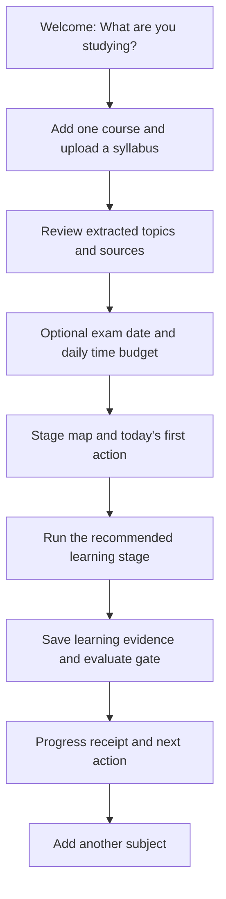

# App-flow reference research

Date: 2026-10-17
Scope: Find a suitable external learning flow for ElevenFolks / Curve. Research and proposed UX only.

## Recommendation

Use RemNote Guided Learn as the main interaction reference, with StudySmarter as a secondary reference for exam planning. Keep Curve's own six-stage learning model and daily queue across subjects.

This fits the direction in product-vision.md and design.md: a calm workspace built around the student's own materials, with a clear next action and visible learning progress.

## Shortlist

| Reference | Evidence | Pattern worth adapting | Fit |
| --- | --- | --- | --- |
| [RemNote Guided Learn](https://help.remnote.com/en/articles/15724936-guided-learn-mode) | Official guide plus REA observations of public entry and signup | Source → guided sections → practice → progress | Strongest main flow |
| [StudySmarter Study Plan](https://www.studysmarter.co.uk/features/study-plan/) | Official feature page; signed-in flow untested | Exam dates informing a personal plan | Supporting planning pattern |
| [Khan Academy Mastery](https://www.khanacademy.org/khan-for-educators/khan-for-educators-advanced-course/x2e5750eab575b791%3Akhan-for-educators-advanced/x2e5750eab575b791%3Amastery-learning-on-khan-academy/a/mastery-learning-on-khan-academy) | Official indexed learning material; signed-in flow untested | Progress earned through demonstrated proficiency | Supporting progression pattern |

These are product-flow references. Visual similarity has not been verified through screenshots.

## What REA observed

REA launched temporary Chrome profiles, navigated to each declared public URL, waited two seconds, and captured the resulting page. It terminated both owned browser processes.

1. **Public entry:** https://www.remnote.com/
   - PDF drop area, file-selection control, and a link input.
   - Public controls for summaries, flashcards, quizzes, and mastery tracking.
   - Signup link pointing to /sign_up.
   - Evidence: `ev_7cd10faed0e040c3b9d93469eb78bca6ea1b05936c81b00b7cdd20599edd762c`.
2. **Signup:** https://www.remnote.com/sign_up
   - Google and Apple sign-in options, email/password fields, and an initially disabled signup button.
   - Evidence: `ev_6a099934bb944355d305c3e891052fc61200d1fe30bb1ef2a5e3d3cddf4a35bd`.

**Documented rather than runtime-tested:** RemNote's guide describes a familiarity baseline, source-based sections, study activities, source navigation, and a tracker updated by practice. Baseline selection changes activity priority rather than the underlying content.

**Unknown:** authenticated onboarding, upload completion, actual generated content, scheduling quality, paywall timing, mobile interactions, and persistence across sessions. Public rendering does not establish these behaviors. No account was created and no student materials were uploaded.

The evidence directory contains selected capture metadata and complete captured accessibility text, not the full REA ledger or captured homepage DOM.

## Proposed Curve flow — design choices

The following is a proposed adaptation, not behavior observed in the reference app.

### First visit

| Screen | Main content | Primary action | Required behavior |
| --- | --- | --- | --- |
| Welcome | Short promise and one material-led starting point | Add a course | Avoid a long preference questionnaire |
| Course setup | Course title, upload, optional exam date | Build my topic map | Show extraction progress; preserve failed uploads for retry |
| Topic confirmation | Extracted topics with source references | Confirm topics | Allow edits; flag uncertain extraction |
| Today | Recommended session, duration, stage, plain-language reason | Start session | Empty state points to upload; one clear main action |
| Learning session | Source access, focused activity, contextual tutor | Submit my work | Save work; resume after interruption |
| Session result | Work recorded, gate result, next review | Continue or finish | Explain unmet gates; show honest progress |
| Course map | Topic stages and suggested next activities | Continue learning | Distinguish completed stage from current mastery |

Start with one course to shorten time to value, then invite a second course to demonstrate the cross-subject planner. Exam date is optional; an undated course must still work. If extracting a full syllabus takes time, show confirmed partial results and explain what is still processing.

### Returning visit

Today → recommended action across subjects → focused session → feedback → updated plan.

The Today screen should answer: what should I study, why now, and how long will it take? Put supporting forecasts and course summaries below that action.

### Preserve the learning method

Use plain student-facing labels while preserving the internal stage vocabulary:

| Internal stage | Suggested student label | Activity |
| --- | --- | --- |
| Priming | Get ready | Build context and questions before class |
| Encoding | Make sense of it | Explain, connect, organize, and submit an artifact |
| Reference | Save the essentials | Review and accept reference items |
| Retrieval | Recall without notes | Complete closed-book retrieval |
| Interleaving | Mix it up | Work through eligible topics across subjects |
| Overlearning | Build exam fluency | Timed practice after required gates clear |

Familiarity is context, not proof of mastery. Preserve the existing PRD exception for material already covered in class, but keep later progression evidence-based. Completing a screen must not itself clear a learning gate.

Retain the PRD's monotonic cleared-stage history. If later performance reveals a weakness, show a review/remediation action without rewriting the student's past progress.

## Visual translation

Follow the existing Curve tokens: pale green background (#F5F8F5), white surfaces, charcoal text (#252824), restrained lavender, blue, and green accents. Use the existing Inter typography and panel radii.

Desktop proposal: compact course navigation, central activity, contextual source/tutor panel. Mobile proposal: one activity at a time with source and tutor in switchable panels. Keep the stage name and primary action visible without making the whole six-stage model compete for attention.

## Research checklist

- [x] Establish fit against product vision and design direction.
- [x] Compare three relevant learning-product patterns.
- [x] Use REA to observe the selected reference's public entry and signup.
- [x] Separate runtime observations, documented behavior, and design proposals.
- [x] Propose first-use, returning-use, learning, and recovery flows.
- [ ] Verify the authenticated reference flow — outside this public, account-free pass.

The research pass changed no application code. Implementation and verification followed on 2026-10-17–18; see app-flow-implementation.md.

